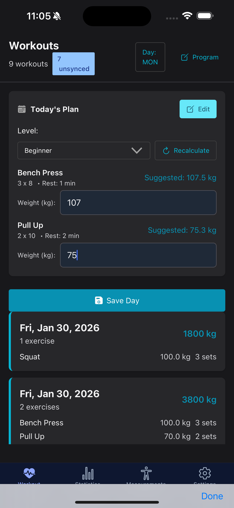
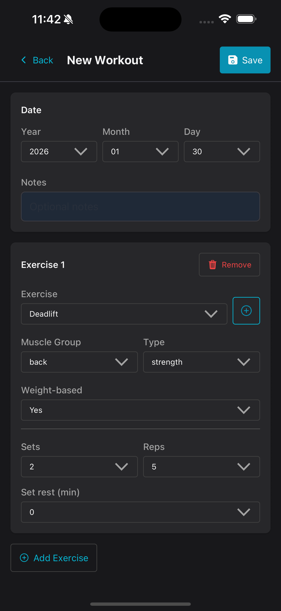
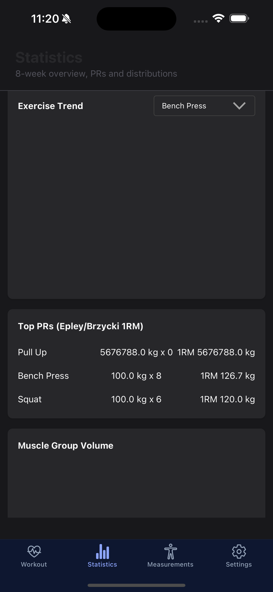
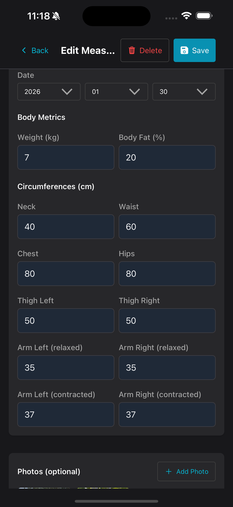
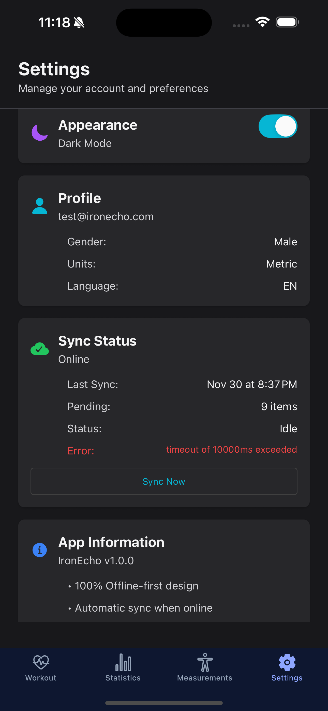

# IronEcho

**Enterprise-Grade, Self-Hosted Fitness Analytics Platform**

[](https://reactnative.dev/)
[](https://nodejs.org/)
[](https://www.mongodb.com/)
[](https://www.docker.com/)

IronEcho is a sophisticated, offline-first fitness tracking ecosystem designed for total data sovereignty. Built with a robust synchronization engine, it seamlessly bridges local-first interactions with a scalable backend architecture, ensuring zero latency during workouts while maintaining perfect data consistency across devices.

## � Key Value Propositions

### 🛡️ Data Sovereignty & Infrastructure Independence
Unlike commercial fitness apps that monetize user data, IronEcho puts you in complete control.
- **Self-Hosted Architecture**: Deploys seamlessly on any Docker-compatible environment—from scalable cloud clusters (AWS/DigitalOcean) to edge devices (Raspberry Pi 5) for a true "Home Lab" experience.
- **Privacy-First Design**: Your health metrics never leave your private infrastructure.

### ⚡ Offline-First Synchronization Engine
Engineered for reliability in gym environments with poor connectivity.
- **Local Persistence**: Utilizes **Realm** for instantaneous local Read/Write operations.
- **Intelligent Sync**: Custom conflict resolution layer ensures data integrity (Last-Write-Wins with server-side validation).
- **Resilience**: Operations are queued and automatically synchronized when connectivity is restored.

### 🧠 Adaptive Progressive Overload
Not just a logger, but an active training partner.
- **Algorithmic Progression**: Automatically calculates weight increments based on gender-specific recovery curves (Male: 5-10%, Female: 3-5%).
- **Performance Analytics**: Real-time volume calculations and PR tracking.

## 📱 Features

IronEcho delivers a comprehensive suite of tools for the serious athlete.

### Workout Engineering
- **Dynamic Session Management**: Advanced logging for Sets, Reps, RPE, and Resting times.
- **Smart History**: Instant access to previous performance metrics during sets.
- **Custom Exercise Registry**: Extensible database supporting Strength, Hypertrophy, and Cardio modalities.

### Analytics Dashboard
- **Volume Visualization**: Interactive charts tracking volume load over time.
- **Frequency Heatmaps**: Visual breakdown of training consistency.
- **Body Metrics**: Long-term tracking of anthropomorphic data (Weight, Body Fat %, Circumference measurements).

### Secure Authentication
- **JWT Architecture**: Stateless authentication with separate Access and Refresh token flows for enhanced security.
- **Session Management**: Secure, persistent login states across app restarts.

## 📸 Mobile App Screenshots

<p align="center">
  
  
  
  
</p>

<p align="center">
  
  
  
  
  
</p>

## 🛠️ Technical Architecture


### Frontend (Mobile)
*   **Core**: React Native + Expo SDK 50+
*   **State/Storage**: Realm (BSON based local DB)
*   **UI System**: NativeBase + Custom Design System
*   **Navigation**: React Navigation 6 (Stack + Bottom Tabs)

### Backend (API)
*   **Runtime**: Node.js + Express
*   **Database**: MongoDB (v7.0+)
*   **Real-time**: Socket.io for bi-directional instant updates
*   **Security**: Helmet, Rate-Limiting, Joi Validator
*   **Deployment**: Docker Compose for containerized orchestration

## 🔧 Installation & Deployment

### Mobile App (Client)

**Option 1: Production Build (EAS)**
The recommended way for performant, native-like experience.
```bash
# Android (APK)
eas build --platform android --profile preview

# iOS (IPA - Requires Developer Account)
eas build --platform ios --profile preview
```

**Option 2: Development Mode**
Ideal for contributors and debugging.
```bash
# 1. Install dependencies
npm install

# 2. Run Pre-build (Required for Realm native modules)
npx expo prebuild

# 3. Start Development Client
npx expo run:android  # or run:ios
```

### Backend Server

**Option 1: Docker (Recommended)**
Deploys the API and Database in isolated containers.
```bash
cd backend/docker
docker-compose up -d
```

**Option 2: Manual Deployment**
```bash
cd backend
npm install
# Configure .env file
npm run dev
```

## 🤝 Contributing

We welcome professional contributions. Please ensure all Pull Requests adhere to the project's strict type-safety (TypeScript) and linting standards.

## 📄 License

MIT License.
